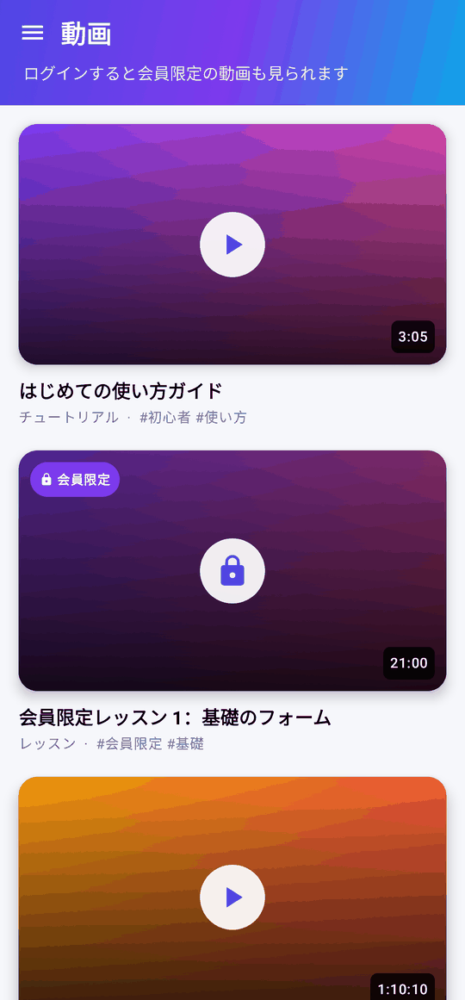
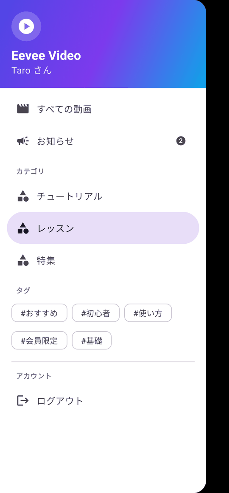
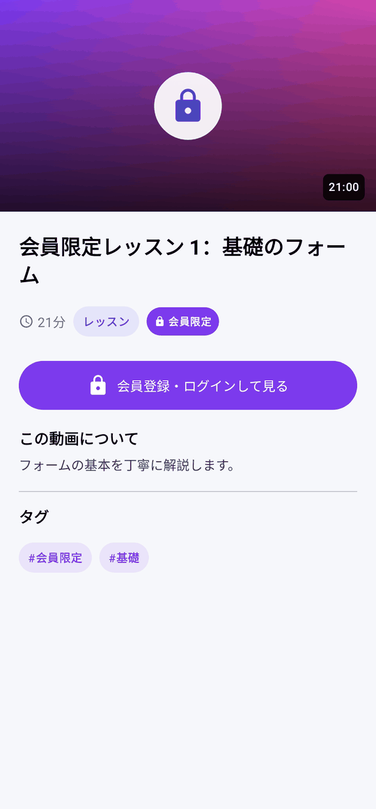
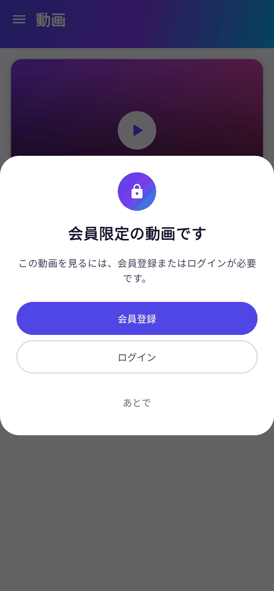
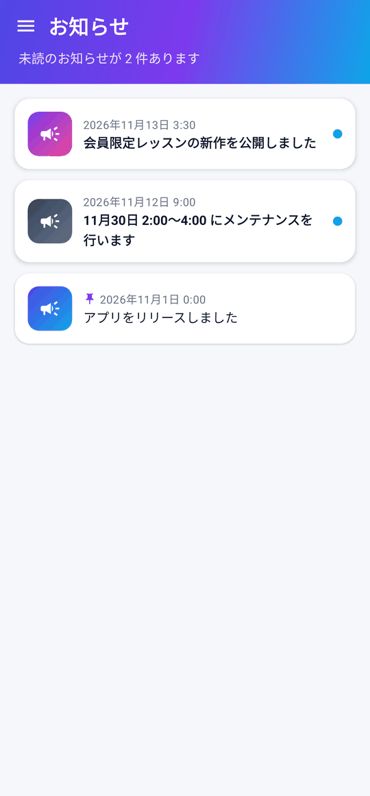

# Eevee Video（Android サンプルアプリ）

app-eevee のアプリ向けAPIを使った、動画配信アプリのサンプルです。Kotlin ＋ Jetpack Compose。

## 画面

| 動画一覧 | メニュー（絞り込み） | 動画詳細 | ログインが必要な動画 | お知らせ |
|---|---|---|---|---|
|  |  |  |  |  |

スクリーンショットはエミュレーターなしで撮れます（Roborazzi ＋ Robolectric）: `./gradlew recordRoborazziDebug` → `app/build/outputs/roborazzi/`

## できること

| 機能 | 内容 |
|---|---|
| 動画一覧 | ログインの有無に関わらず**全動画**を表示する。16:9 のカードに再生時間、会員限定には鍵と「会員限定」の印。読み込み中はスケルトン表示、下に引っ張ると再読み込み |
| メニュー | 左上のハンバーガー（または左端からスワイプ）で開く。すべての動画、お知らせ（未読数のバッジ）、カテゴリ・タグでの絞り込み、ログイン・会員登録・ログアウト |
| 動画詳細 | サムネイルの再生ボタンでその場で再生。説明・カテゴリ・タグ・再生時間を表示し、カテゴリやタグをタップすると一覧を絞り込む |
| お知らせ | 一覧（ピン留め・未読の印、引っ張って再読み込み）と詳細（本文は app-eevee が返す安全な HTML）。ログイン中は開くと既読になる |
| ログインが必要な動画 | 未ログインで会員限定の動画をタップすると、**「会員登録またはログインが必要です」のポップアップ**（会員登録 / ログイン / キャンセル） |
| 会員登録・ログイン・ログアウト | app-eevee の builtin 方式（メールアドレス＋パスワード）。ログイン時に端末をユーザーに紐づけ、ログアウト時に外す |
| 再生 | Media3 ExoPlayer で HLS を再生。30 秒ごとのハートビート、画面を閉じたら停止。同時視聴の上限・他の端末での再生開始（kicked）・期限切れはダイアログで案内 |
| プッシュ通知 | FCM。起動時とトークン更新時に端末を登録。通知タップで開封を記録し、data が `type=video` / `id={動画ID}` ならその動画の再生画面を開く |

## 必要なもの

- Android Studio（最新の安定版）。JDK 17 以上
- 接続する app-eevee（ローカルの Sail、または Laravel Cloud の本番環境）と、そのアプリの `app_key`
  - アプリの認証方式は **builtin**（会員登録・ログインをこのアプリから行うため）
- プッシュを試す場合: Firebase プロジェクト

## セットアップ

### 1. 接続先

`samples/android-video/local.properties`（コミットしない）に書きます。書かなければ `gradle.properties` の既定値（エミュレーターからローカルの Sail、デモの `ak_demo_oneframe_app`）を使います。

```properties
sdk.dir=/path/to/Android/sdk
# 本番の app-eevee（Laravel Cloud）に接続する例
eevee.baseUrl=https://app-eevee-xxxx.laravel.cloud
eevee.appKey=ak_xxxxxxxxxxxxxxxx
```

- エミュレーターからローカルの Sail に接続する場合は `http://10.0.2.2`（debug ビルドだけ http を許可しています）。
- 実機からローカルの Sail に接続する場合は、PC の LAN の IP アドレス（例: `http://192.168.1.10`）にし、`app/src/main/res/xml/network_security_config_debug.xml` にその IP を追加してください。

### 2. Firebase（プッシュ通知を使う場合）

1. Firebase コンソールで Android アプリを追加する。パッケージ名は **`com.example.eeveevideo`**（変える場合は `app/build.gradle.kts` の `applicationId` も変える）。
2. `google-services.json` をダウンロードして `samples/android-video/app/` に置く（コミットしない）。
3. 同じ Firebase プロジェクトのサービスアカウントの JSON を、app-eevee の管理画面 → アプリ設定 → Firebase に登録する。

`google-services.json` がなくてもビルド・起動はでき、プッシュだけが無効になります（`BuildConfig.FCM_ENABLED`）。

### 3. 実行

Android Studio で `samples/android-video` を開いて実行するか:

```bash
cd samples/android-video
./gradlew installDebug
```

## app-eevee 側の準備

- **動画**: 管理画面 → 動画 で登録する。公開範囲が「メンバー限定」の動画が、未ログイン時にポップアップの対象になります。
  - 本番で再生するには、アプリ設定で Cloudflare Stream を設定し、動画をアップロードして「再生可能」にする。
  - **ローカル（Sail）で Cloudflare なしに試す場合**は、app-eevee の `.env` で `EEVEE_VIDEO_FAKE=true` にしてデモデータ（`sail artisan migrate --seed`）を使う。再生 API が公開のテスト用 HLS を返すので、実際に再生できます。
- **プッシュのテスト**:
  1. このアプリを起動して通知を許可する（端末が app-eevee に登録される）。
  2. 管理画面 → 端末 で自分の端末を「テスト端末」に登録する（ログインしていればユーザー ID で探せる）。
  3. 管理画面 → プッシュ配信 で作成し、「テスト配信」。data に `type=video` と `id={動画ID}` を入れると通知のタップでその動画が、`type=notice` と `id={お知らせID}` ならそのお知らせが開きます。
  4. キャンペーン詳細の開封数が増えれば、開封記録も動いています。

## 構成

```
app/src/main/java/com/example/eeveevideo/
  EeveeVideoApp.kt          Application（通知チャンネルの作成）
  MainActivity.kt           通知の許可、起動時の端末登録、通知タップ（開封記録・画面遷移）
  data/EeveeApi.kt          app-eevee のアプリ向けAPIのクライアント（OkHttp + kotlinx.serialization）
  data/AppContainer.kt      ログイン状態、端末登録（FCM トークン・通知の許可状態）
  data/SessionStore.kt      installation_id とトークンの保存（DataStore）
  push/EeveeMessagingService.kt  FCM（トークン更新、フォアグラウンドでの通知表示）
  ui/Root.kt                画面遷移とメニュー（ModalNavigationDrawer）、通知タップの振り分け
  ui/AppDrawer.kt           ハンバーガーメニュー（カテゴリ・タグの絞り込み、お知らせ、アカウント）
  ui/VideoListScreen.kt     動画一覧（ログインが必要な動画はポップアップ）
  ui/VideoDetailScreen.kt   動画詳細・再生・ハートビート・停止
  ui/NoticeScreens.kt       お知らせ一覧・詳細
  ui/AuthScreens.kt         会員登録・ログイン
  ui/Theme.kt, Components.kt  テーマとデザイン部品（スケルトン、再生時間のバッジ、空のときの表示など）
```

## サンプルとしての割り切り（本番アプリで追加・変更すること）

- トークンは DataStore に平文で保存しています。本番では EncryptedSharedPreferences や Keystore で暗号化してください。
- パスワード再設定、通知カテゴリの設定の画面はありません（API は app-eevee にあります。`docs/client-integration.md`）。
- 動画一覧は最大 100 件、お知らせは最大 50 件を1ページだけ読み込みます（無限スクロールなし）。メニューのカテゴリ・タグは、読み込んだ動画から作っています。
- バックグラウンドに入ったときの再生停止・PiP には対応していません（画面を閉じると停止を送ります）。
